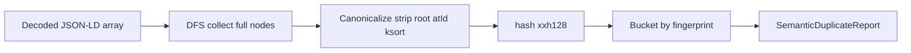

# JSON-LD semantic duplicate detection (type/property agnostic)

## Context

Final payload is built in [`SchemaOutputService::composeJsonLdOutputScriptTagForResolvedSlots`](app/Services/SchemaTemplates/SchemaOutputService.php): `$output = ['@context' => …, '@graph' => $graph]` then `json_encode`. After your allocator fix, **monotonic template-instance suffixes** can yield **multiple full nodes** whose non-`@id` JSON is identical (or structurally equivalent under chosen rules) but **different `@id`s**—by design for merge-safety. Detection should quantify that without committing to a dedupe policy.

[`SchemaJsonLdRealPersonEntriesTest`](tests/Feature/SchemaJsonLdRealPersonEntriesTest.php) already decodes the script tag and DFS-walks the tree (e.g. `accumulateJsonLdNodeShapeCountsByAtId`, `findAnyNodeByAtId`). Reuse the same **“full node”** definition: associative array with non-empty string `@id` and **at least one key other than `@id`**.

## Design: post-build fingerprint (your option 1), fully generic

Introduce a dedicated class under schema templates, e.g. [`app/Services/SchemaTemplates/SchemaJsonLdSemanticDuplicateAnalyzer.php`](app/Services/SchemaTemplates/SchemaJsonLdSemanticDuplicateAnalyzer.php) (name negotiable), with a **single public entry point** such as `analyzeDecodedDocument(array $decoded): SemanticDuplicateReport`.

**Collection**

- DFS from `$decoded` (entire document, not only top-level `@graph` items), same spirit as the Leslie test helpers.
- Collect each **full node** once per visit (by object identity is unnecessary in PHP if you only hash each array value when you classify it as a full node; **same logical node could appear twice in tree** only if duplicated in data—still worth fingerprinting each occurrence or dedupe by `spl_object_id` is N/A for arrays). Simplest: every time you see a qualifying associative array, treat it as a candidate (if the same subtree is shared by reference it won’t happen in `json_decode` output—each occurrence is a separate array).

**Canonicalization (type/property agnostic)**

- Deep-copy the node (or build a new tree) and **remove only the root fingerprinted object’s `@id`** for the hash input (keep nested `@id`s as part of structure so two subgraphs that differ only by a child’s `@id` still differ—avoids over-merging).
- **Recursive `ksort`** on every associative (non-list) array at all depths so key order never affects the hash.
- **Lists** (`array_is_list`): default behavior **preserve element order** (minimizes false positives for ordered JSON-LD lists). Expose an **opt-in** flag on the analyzer, e.g. `$options->sortListElements`, default `false`: when `true`, sort list elements by a stable comparator (e.g. `strcmp` of `json_encode` of each element’s canonical form) for stricter “multiset” equality—document that this can false-positive on order-sensitive lists.

**Fingerprint**

- `json_encode($canonical, JSON_UNESCAPED_SLASHES | JSON_UNESCAPED_UNICODE | JSON_THROW_ON_ERROR)` then `hash('xxh128', $json)` (or `sha256` if you want zero extension dependency—`xxh128` is core in PHP 8.1+).

**Grouping**

- Bucket by fingerprint hash; for each bucket with **≥2 distinct `@id` values** among collected nodes, emit a **group** in the report: `{ fingerprint, atIds[], sampleCount }` (no `@type` dimension—keeps grouping type-agnostic; accidental cross-type collision is extremely unlikely if non-`@id` bodies differ).

**Report object**

- Immutable DTO(s): e.g. `SemanticDuplicateReport` with `groups: list<SemanticDuplicateGroup>`, plus aggregates `totalFullNodesScanned`, `groupCount`, `maxGroupSize`.

**Documented limitations** (class docblock + optionally one paragraph in [`app/Services/SchemaTemplates/README.md`](app/Services/SchemaTemplates/README.md) only if you want ops visibility): list-order sensitivity when `sortListElements` is off; possible false positives when `sortListElements` is on; nodes that differ only in keys you might later choose to strip (e.g. future provenance fields) will not group together.

## Tests

1. **Unit tests** (new file under `tests/Unit/Services/SchemaTemplates/`): synthetic arrays—two full nodes, same keys/values except `@id` → one duplicate group; compact-only nodes ignored; nested structures + `ksort` stability; optional branch for `sortListElements=true` on two lists with different order same multiset.

2. **Feature / golden** (choose one, avoid brittle `@id` literals where possible):
   - Either extend Leslie test with a **single** assertion that `analyzeDecodedDocument($decoded)` returns **at least one** duplicate group (proves the detector sees the real-world occupation pattern), **or** add a dedicated small feature test that renders a **minimal fixture** if you want to avoid coupling to Leslie’s exact duplicate count.
   - Prefer **not** snapshotting exact duplicate counts on Leslie unless you want CI to fail on every allocator tweak; better: assert analyzer runs, groups have distinct `@id`s, and optionally assert a **minimum** count or that a fingerprint bucket contains **two** ids matching a regex for occupation template suffix—only if you need a tight regression signal.

## Optional follow-ups (out of scope unless you ask)

- **Artisan command** that resolves an entry/URL, calls `SchemaOutputService::outputForCurrentContext()` (or a test helper), prints report JSON/table—nice for local triage, not required for detection logic.
- **Emit-time map** (your option 2): hook near `schemaObjectEntryToNode` / standalone build—more invasive; defer until post-build metrics justify it.

## Mermaid (data flow)

